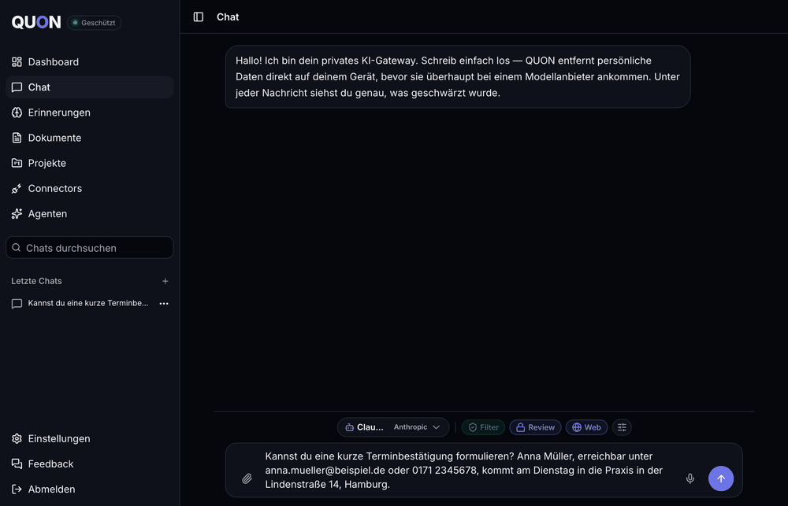

# QUON — Your Private AI (core edition)

[](./LICENSE)

> A privacy gateway for chatting with frontier LLMs. Personal data is detected and
> replaced with typed placeholders **on your side** before anything reaches a model
> provider — then re-hydrated locally in the answer, so the conversation reads
> naturally while your PII never leaves the perimeter.

```
You type ──▶ QUON scrubs PII locally ──▶ scrubbed text + placeholders ──▶ LLM provider
                                                                              │
You read ◀── placeholders re-hydrated locally ◀── answer (placeholders kept) ◀┘
```



_Review mode: you see precisely what leaves the device. The provider receives
`[PERSON_1]`, `[EMAIL_1]`, `[PHONE_1]` — the answer comes back with the real values
restored locally. (UI shown in German; English is available.)_

QUON is built for people who must use AI on sensitive material — tax advisors,
lawyers, doctors, anyone under GDPR — without handing names, emails, IBANs or
case details to a third-party model.

> **This is the core edition (0.10).** It contains the privacy gateway itself —
> detection, the filtered chat, encrypted accounts and sync, memory, documents,
> projects and the self-host stack — and deliberately leaves out features that
> are not yet settled or that reach outside the box (connectors, chat tools,
> agents, shared projects, native apps). [docs/CORE.md](./docs/CORE.md) lists
> what is in, what waits, and the criteria for a feature to come back.
>
> **Status: beta.** Self-host at your own risk and read the
> [threat model](./docs/threat-model.md) before trusting it with sensitive data.

---

## What's in this repo

| Path                     | What it is                                           | Stack                                                  |
| ------------------------ | ---------------------------------------------------- | ------------------------------------------------------ |
| `quon-scrubber-service/` | **Backend** — on-device PII detection + chat relay   | FastAPI, Presidio, spaCy, GLiNER                       |
| `src/`                   | **Frontend** — the QUON web app                      | TanStack Start (React 19, SSR), Tailwind v4, shadcn/ui |
| `deploy/`                | Docker Compose + Caddy deployment                    | shell scripts                                          |
| `ARCHITECTURE.md`        | Deep-dive: data flows, detection pipeline, ZK design | —                                                      |

The two components run independently and talk over HTTP. The frontend is useless
for privacy without the backend — if the scrubber is unreachable, the app **fails
closed** (sending is paused, status goes red) rather than leaking raw text.

## Quick start (self-hosting)

```bash
cp .env.example .env        # set QUON_DOMAIN, QUON_SERVER_SECRET, an OpenRouter key
docker compose up -d --build
```

Then turn the third detector on (`GLINER_ENABLED=true` in `.env`) — it ships off
so a first start does not download 1.5 GB before answering, but the reference
deployment runs it on. Everything else, including backups and the environment
reference, is in [docs/self-hosting.md](./docs/self-hosting.md).

## Development

```bash
npm install && npm run dev                                   # frontend on :8080
cd quon-scrubber-service && python -m venv .venv \
  && ./.venv/bin/pip install -r requirements-dev.txt \
  && ./.venv/bin/uvicorn main:app --reload                   # backend on :8000
npm run typecheck && npm run lint && npm test                # frontend checks
cd quon-scrubber-service && ./.venv/bin/python -m pytest -q  # backend tests
```

The end-to-end suite (`npm run e2e`, Chromium + WebKit) runs in CI; see
[CONTRIBUTING.md](./CONTRIBUTING.md).

## Documentation

- [ARCHITECTURE.md](./ARCHITECTURE.md) — how the pieces fit, the detection pipeline, the zero-knowledge design
- [docs/threat-model.md](./docs/threat-model.md) — what QUON protects against, and what it does not
- [docs/self-hosting.md](./docs/self-hosting.md) — running your own instance
- [docs/CORE.md](./docs/CORE.md) — what this edition contains and why
- [SECURITY.md](./SECURITY.md) — reporting a vulnerability

## License

GNU Affero General Public License v3.0 — see [LICENSE](./LICENSE). The QUON name
and logo are trademarks and not covered by the licence; see
[TRADEMARKS.md](./TRADEMARKS.md).
