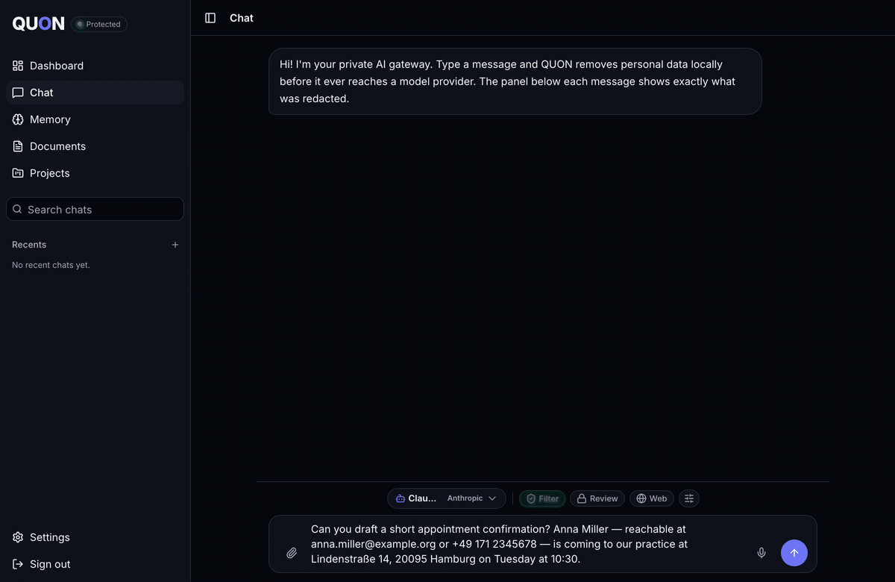
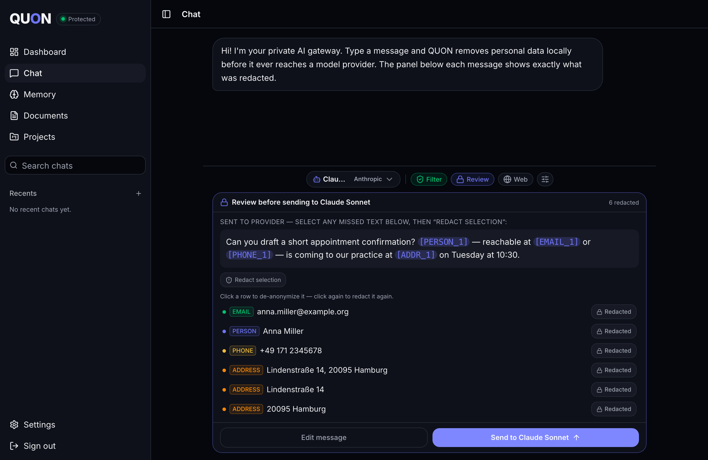

# QUON — Your Private AI

[](./LICENSE)

> A privacy gateway for chatting with LLMs. Personal data is detected and
> replaced with typed placeholders **on your side** before anything reaches a
> model provider. In the answer they are restored locally, so the conversation
> reads naturally and names, addresses, numbers and IDs never leave your
> perimeter.

```
You type ──▶ QUON scrubs PII locally ──▶ scrubbed text + placeholders ──▶ LLM provider
                                                                              │
You read ◀── placeholders re-hydrated locally ◀── answer (placeholders kept) ◀┘
```





_Review mode: you see exactly what leaves the device. The provider receives
`[PERSON_1]`, `[EMAIL_1]`, `[PHONE_1]`; the answer comes back with the real
values restored locally._

## What you get

- **Redaction you can see.** Three detectors run on your server (spaCy/Presidio
  NER, GLiNER span scoring and a deterministic regex net), then a guard chain,
  and the panel under every message shows what was replaced. _Filter_ sends
  automatically; _Review_ stops before every send; your own always- and
  never-redact lists apply on top. When the detector is down, sending is
  paused. It never falls back to raw text.
- **Any model, any provider.** The whole [OpenRouter](https://openrouter.ai)
  catalogue with one shared key or a key each user brings. Your own
  OpenAI-compatible endpoints (OpenAI, Groq, Together, Anthropic's
  compatibility endpoint and so on), added under _Settings > Providers &
  models_. And **fully local models**: Ollama, LM Studio or vLLM on the same
  box or in your LAN (`ALLOW_PRIVATE_PROVIDER_URLS=true`). Switch the model per
  chat. Optional web search through the provider.
- **Everything else stays on the device.** Documents (PDF and DOCX text,
  on-device OCR for photos), memory and semantic search use embeddings
  computed in the browser; chats, memory, documents and projects sync between
  your devices as ciphertext the server cannot read.
- **Accounts without a service in the middle.** Password plus a recovery
  phrase, optional passkey unlock, zero-knowledge key wrapping; a first
  account on a fresh instance becomes its admin. German and English.
- **Self-hosted in one command.** `docker compose up` with Caddy for TLS, on a
  public domain, a home server or a Tailscale network.

Still being prepared for release: connectors (Dropbox, OneDrive, Paperless,
IMAP), tools the model can call, scheduled agents, shared projects, and the
desktop and Android apps.

> **Status: beta.** Self-host at your own risk and read the
> [threat model](./docs/threat-model.md) before trusting it with sensitive data.

---

## What's in this repo

| Path                     | What it is                                           | Stack                                                  |
| ------------------------ | ---------------------------------------------------- | ------------------------------------------------------ |
| `quon-scrubber-service/` | **Backend**: on-device PII detection and chat relay  | FastAPI, Presidio, spaCy, GLiNER                       |
| `src/`                   | **Frontend**: the QUON web app                       | TanStack Start (React 19, SSR), Tailwind v4, shadcn/ui |
| `deploy/`                | Docker Compose + Caddy deployment                    | shell scripts                                          |
| `ARCHITECTURE.md`        | Deep-dive: data flows, detection pipeline, ZK design |                                                        |

The two components run independently and talk over HTTP. The frontend is useless
for privacy without the backend: if the scrubber is unreachable, the app **fails
closed** (sending is paused, status goes red) rather than leaking raw text.

## Quick start (self-hosting)

```bash
cp .env.example .env        # set QUON_DOMAIN, QUON_SERVER_SECRET, an OpenRouter key (or none: BYOK)
docker compose up -d --build
```

The shipped `.env.example` turns the third detector on (`GLINER_ENABLED=true`),
so the first start downloads its ~1.5 GB model once before the scrubber reports
ready. Without an SMTP relay, accounts are active the moment they are created.
Everything else (a home network without a public domain, backups, the full
environment reference) is in [docs/self-hosting.md](./docs/self-hosting.md).

## Development

Node 20+ and Python 3.11+.

```bash
# backend on :8000; the dev .env turns cookie security off, prod refuses to boot without it
cd quon-scrubber-service && python -m venv .venv \
  && ./.venv/bin/pip install -r requirements-dev.txt \
  && cp .env.example .env && sed -i.bak 's/^COOKIE_SECURE=.*/COOKIE_SECURE=false/' .env \
  && ./.venv/bin/uvicorn main:app --reload
# frontend on :8080; /api is proxied to the backend so the session cookie stays same-site
cd .. && npm install && cp .env.example .env \
  && sed -i.bak 's#^VITE_QUON_API_URL=.*#VITE_QUON_API_URL=/api#' .env && npm run dev
```

Register an account in the app; without SMTP it is active right away. Then run
the checks:

```bash
npm run typecheck && npm run lint && npm test                # frontend
cd quon-scrubber-service && ./.venv/bin/python -m pytest -q  # backend
npm run e2e                                                  # Chromium + WebKit, ~7 min on a laptop
```

See [CONTRIBUTING.md](./CONTRIBUTING.md) for the rest.

## Documentation

- [ARCHITECTURE.md](./ARCHITECTURE.md): how the pieces fit, the detection pipeline, the zero-knowledge design
- [docs/threat-model.md](./docs/threat-model.md): what QUON protects against, and what it does not
- [docs/self-hosting.md](./docs/self-hosting.md): running your own instance, on a public domain or at home
- [docs/extending.md](./docs/extending.md): contributing a detector, a recognizer or an entity type
- [SECURITY.md](./SECURITY.md): reporting a vulnerability

## License

GNU Affero General Public License v3.0, see [LICENSE](./LICENSE). The QUON name
and logo are trademarks and not covered by the licence; see
[TRADEMARKS.md](./TRADEMARKS.md).
